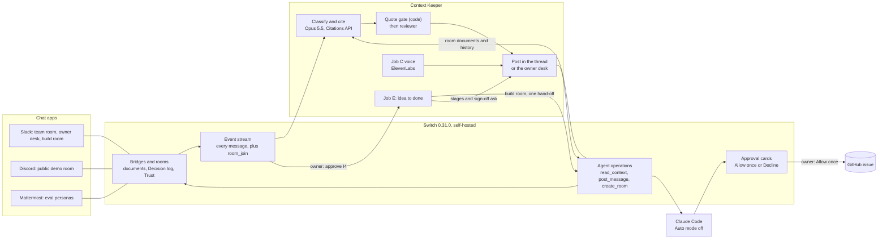
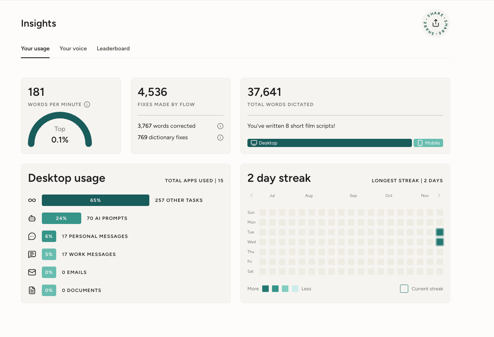

<p align="center">
  <picture>
    <source media="(prefers-color-scheme: dark)" srcset="docs/img/context-keeper-logo-dark.svg">
    
  </picture>
</p>

<h3 align="center">From “didn’t we decide this?” to “it’s built”, right in your team chat.</h3>

<p align="center">Your team chat's memory: it answers with the source, catches you up, and turns new ideas into work.</p>

<p align="center">
  <a href="https://ck.kashifnazir.com/status"><b>Live status</b></a> ·
  <a href="https://youtu.be/7x0Uy3UgCZQ"><b>3-min demo</b></a> ·
  <a href="https://kashifnazir.com/blog/building-context-keeper-on-switch/"><b>Blog</b></a>
</p>

<p align="center"><a href="https://youtu.be/7x0Uy3UgCZQ"></a></p>

<!-- VIDEO: optionally drag the mp4 into this README on GitHub to embed it inline -->

<p align="center">
  <a href="https://discord.gg/ygPnp7bj5"></a>
  <a href="https://ck.kashifnazir.com/status"></a>
</p>
<p align="center">
  <a href="#use-of-switch"></a>
  <a href="JUDGES.md#how-the-channels-are-set-up"></a>
  <a href="#how-it-works"></a>
  <a href="#how-it-works"></a>
  <a href="docs/voice-resources.md"></a>
  <a href="JUDGES.md#safety"></a>
  <a href="docs/deploy-cloud.md"></a>
  <a href="package.json"></a>
  <a href="#tests"></a>
  <a href="LICENSE"></a>
</p>

**WeMakeDevs × Switch: Flip the Switch** · track: Best Business Workflow · built solo, November 2026

**Built with** Switch 0.31.0 (self-hosted), Switch Console and Switch Trust · Claude Opus 5.5, Sonnet 5.5 and Haiku 5.5 (Citations API) · Claude Code · ElevenLabs · Slack, Discord, Mattermost · Google Cloud · TypeScript on Node 22 · Wispr Flow

<!-- Kash's words: form answers (dictated 4 Nov); grammar fixes and trims only -->
Keeping a handle on what's going on has always been quite difficult: what has someone already proposed? What decision has already been made? New people are joining a project I've been working on for a while and saying, "Wouldn't it be great if we had automated testing in there?" Well, yes, we already have that. The cost is the other people having to re-explain to that person over and over again. With Context Keeper, we track what's going on in the Slack chat, Discord, or whatever messaging app you want to use. It stays quiet on chatter and doesn't invent decisions; that's very important. I want everything to be evidence-based.

> [!IMPORTANT]
> **Built around Slack. The Discord channel is an extremely simplified demo.** It has cited answers and voice (an audio brief and a "talk it through" call, under a daily cap). Ideas built by Claude Code, stage updates and sign-offs run in **Slack**, the full version shown in the demo video. If something isn't in the Discord demo, that's because it's switched off there, not because Context Keeper can't do it.

| Headline result | |
|---|---|
| Live test set: 24 cases, the real agent on a real Switch server | **23/24** |
| Confident wrong ("covered" when it isn't, or without a citation) | **0**, in every logged eval run |
| Median time from the post to a cited reply | **15.5 s** |
| Robustness: kill, restart and starve the live agent | **8 of 8** checks pass (first full run 6/9; each fail fixed and re-run) |
| Clean clone on an empty Ubuntu VM to a cited answer | **about 4.5 min** |

<p align="center"></p>

### Try it in 60 seconds

1. Join **[the Discord demo](https://discord.gg/ygPnp7bj5)** and open `#try-context-keeper`. Nobody has to tag it.
2. Ask, as if you were on the Ledgerly team:
   - "Why don't we run the pilot with five agencies instead of three?" (a settled decision, quoted with who decided, when, and what would reopen it)
   - "Could we add automatic payment reminders for overdue invoices?" (a feature that already exists)
   - "Can we add a QuickBooks integration for the pilot?" (parked for later, not rejected, with the reason)
3. Open **[the live status page](https://ck.kashifnazir.com/status)**: rooms, today's replies and silences, where each idea is, and today's spend against the cap.

Small talk gets no reply, on purpose. **Switched off on Discord:** Claude Code builds, stage updates and sign-offs (they need the owner's approval clicks). Limits there: 6 replies per person per hour, one voice brief per person per day, and a daily spend cap.

Judges: [JUDGES.md](JUDGES.md) has the five-minute tour and the known limits, plus the five jobs, how the channels are set up and safety in full.

## Why it's different

- **Nobody has to tag it.** It reads every message in the room and only speaks when it has something with a source. The person asking "why don't we…?" doesn't know it's already decided, so they'd never tag an agent.
- **Code decides what counts as "covered".** It never says "already covered" without a quote that code has checked word for word against the source, and a second model checks the quote backs the claim. Code can only make a verdict more cautious.
- **From idea to done, with people deciding.** A new idea goes on the idea log; the owner types `approve I4`; Claude Code builds it in its own room behind Switch's approval cards; the person who raised it signs it off in their original thread.
- **It catches you up by voice.** Come back after a break and you get a short brief, a 60-second audio version and a "Talk it through" link to a voice agent that knows the room's record.

## How it works

"The model proposes, code decides." One Opus 5.5 call returns a verdict with Citations API spans; the quote gate checks each quote against its source; a reviewer model checks the quote backs the claim. The full diagram and each step with its code: [JUDGES.md](JUDGES.md#how-it-works-step-by-step).



## Use of Switch

<!-- Kash's words: form answers (dictated 4 Nov); grammar fixes and trims only -->
Switch is what lets us share a common layer between the different agents, whichever chat app you use. The rooms are probably the best thing, because they give us the bridges between Slack and Discord, and Claude Code's approval cards. That's really helpful: it means we have a human in the loop and we're actually verifying things instead of blindly letting it automate. With Switch Trust, we've got a safety layer on the prompts going through.

### What breaks without Switch

<!-- drafted by Claude from the code; Kash to check -->
Context Keeper has no Slack, Discord or Mattermost client of its own for posting, and no database for the team's record: both are Switch. Take a piece away and this is what stops.

| Switch piece | What Context Keeper does with it | Without it |
|---|---|---|
| Rooms and the agent protocol's event stream (`filter=all`, `list_rooms`, `connect_to_room`, a saved stream position) | Hears every message, tagged or not, batches each person's burst and decides; a restart resumes from the saved position ([src/agent/main.ts](src/agent/main.ts), [vendor/switch-agent-runtime/](vendor/switch-agent-runtime/)) | Nothing triggers jobs A to E: the person asking "why don't we…?" never tags an agent, so the agent never hears the question. Messages sent while it was down would be lost instead of answered once |
| Slack, Discord and Mattermost bridges | Every post is one `post_message` through the room, whichever app the room is on; the Slack and Discord bot tokens are only read to turn handles into display names ([src/agent/main.ts](src/agent/main.ts) `poster`, [src/names.ts](src/names.ts)) | One posting integration per chat app. The Slack team room, the public Discord room ([docs/demo-channel.md](docs/demo-channel.md)) and the Mattermost eval ([eval/](eval/)) would be three separate builds instead of one agent on one server |
| Room documents (`list_references`, `load_internal_documents`), room history (`read_context`) and the agent-owned "Decision log" (`create_room_document`, `update_room_document`) | The room's record, read before each decision and cited in every answer; job B writes decisions back into the Decision log, which job A then cites ([src/agent/memory.ts](src/agent/memory.ts), [src/agent/decision-log.ts](src/agent/decision-log.ts)) | No record to quote. The quote gate only lets "covered" through with a verbatim quote from a source ([src/agent/post.ts](src/agent/post.ts)), so answers would fall back to silence or "new", and decisions would have nowhere shared to live |
| `room_join` events (`join_event_listeners`) | Marks a newcomer so their first message gets the job C catch-up ([src/agent/main.ts](src/agent/main.ts), [src/agent/state.ts](src/agent/state.ts), [src/agent/jobs/brief.ts](src/agent/jobs/brief.ts)) | The brief would rest on the record alone: only a first-ever message, or one after `CK_RETURN_GAP_DAYS` of silence, would get one |
| `create_room` + `send_targeted_message`, and Claude Code's approval cards | Job E opens the build room on the same bridge, sends Claude Code one targeted hand-off with the cited context, and each of Claude Code's steps waits for the owner's "Allow once" ([src/agent/handoff/switch.ts](src/agent/handoff/switch.ts), [docs/handoff-live-test.md](docs/handoff-live-test.md)) | Job E stops at "noted": no build room, no hand-off to Claude Code, and no per-step human approval. A custom agent can't raise approval cards itself (see [Known limits](#known-limits)) |
| Switch Trust | A Jailbreak policy on the room's user messages, action Alert, turned on for the server; the flag shows in the channel and the message still reaches the agent ([blog/build-log.md](blog/build-log.md)) | No server-side flag on jailbreak attempts in the channel. The agent's own guards (chat treated as data, the quote gate, the reviewer) still apply |
| Gateway admin API | `scripts/server-up.sh` mints the agent's registration key (`POST /gateway/api-keys`); the eval creates, populates and archives a fresh set of rooms per run ([eval/switchapi.ts](eval/switchapi.ts)); Trust was switched on with `PUT /gateway/trust-settings`. The seed itself uses the agent's own operations ([seed/switch.ts](seed/switch.ts)) | A custom agent can't register (see [why we run our own Switch server](JUDGES.md#why-we-run-our-own-switch-server)), and the 24-case eval couldn't make fresh rooms for each run |

Every Switch feature it uses, the agents connected, and where it sits on Switch's levels (Level 3, shown live): [JUDGES.md](JUDGES.md#use-of-switch-in-detail).

## Results

The eval runs the **real agent** against the **real Switch server**, in real time: personas post each case into fresh rooms, and a scorer reads back what the agent posted. Latest full run, `r20261104-1826-08e4` ([report](testset/results/2026-11-04-claude-opus-5-5-12.md)):

| Measure | Result |
|---|---|
| **Overall, 24 cases** | **23/24** |
| Job A, already covered? (17) · job D, preference or constraint (4) · job B (1) · quiet on chatter (2) | 16/17 · 4/4 · 1/1 · 2/2 |
| **Confident wrong** | **0**, and 0 in every one of the 19 runs in [facts.md](facts.md) |
| Median time from the post to the reply | 15.5 s (22 replies) |
| Estimated model spend for the whole run | $0.95 (an upper bound) |

**Robustness** (`npm run eval -- --robustness`): eight checks that kill, restart and starve the live agent. The first full run passed 6/9 (R7 has two parts). R2 and the R7b check were fixed and R5 (retract) was built, then each passed on re-run.

The one miss (T18), every run in order, citations, speed and the robustness table: [docs/results.md](docs/results.md). Every number comes from [facts.md](facts.md), which the eval appends to on every run, failures included.

## Run it locally

From a clean clone to a cited answer in a chat room on your own machine, with no Slack or Discord: Switch's self-hosted server plus the Mattermost in Switch's own Compose file. Needs Node 22+, Docker with Compose v2, python3, curl, openssl and an Anthropic API key (on an Apple Silicon Mac, run Docker with Rosetta).

```bash
git clone https://github.com/thekashifnazir/context-keeper && cd context-keeper
cp .env.example .env                        # fill in the existing ANTHROPIC_API_KEY= line
npm ci
scripts/server-up.sh --with-mattermost      # Switch 0.31.0 + Gateway + Mattermost; registers the agent
npm run ck -- doctor                        # health, ports, stream, bridge
npm run seed -- --bridge mattermost --demo ledgerly --room-name ck-smoke-trial --owner-username user
npm run agent                               # leave it running
```

Then post "Why don't we run onboarding on Saturdays?" in `ck-smoke-trial` at `http://127.0.0.1:18065`. Step by step, with timings and what each check should print: **[docs/run-it.md](docs/run-it.md)**. Linux setup, ports and clean-up: [JUDGES.md](JUDGES.md#run-it). Slack and Discord bridges: [JUDGES.md](JUDGES.md#how-the-channels-are-set-up). Running it 24/7 on a cloud VM: [docs/deploy-cloud.md](docs/deploy-cloud.md).

### Tests

```bash
npm test                              # 388 offline tests (vitest); no keys, no network
npx tsc --noEmit
npm run eval -- --fast --only T05     # one live case end to end (needs the stack above)
npm run eval                          # the whole 24-case set
```

## Known limits

- **Agents can't react to or edit their posts**, so job E posts one short line per real stage change.
- **A custom agent can't raise Switch's approval cards.** Job B's confirm is a text reply from the owner; job E still gets Claude Code's real cards.
- **Chat sources are named, not linked:** Switch gives agents no message permalink, so a chat source reads "Rowan, 4 Nov".
- **Covered or parked is sometimes a judgement call** (T18), left as an honest miss rather than tuned to the test.
- **One VM, no automatic backups.** The full list and what's next: [JUDGES.md](JUDGES.md#limits-and-whats-next).

## What I liked about Switch, and what I'd improve

<!-- Kash's words: form answers (dictated 4 Nov) and blog/source.md; grammar fixes and trims only -->
**Liked**

- The local test chat (Mattermost) that comes with it. That was really helpful for automated testing.
- That you can connect to lots of different messaging apps. I use Slack because it's work-appropriate and the one I use most at work, and Discord because it's the one I use outside work. Discord is also easy to share out.
- Switch Trust is the one I really like the most. You can add your own trust policy and have a lot of control over it, which would normally need a huge dedicated system; this looks like something you can just add into your existing systems.
- It feels quite easy to add additional features.
- How fast Phil got back to me on Discord, and that he confirmed the path I was already going down.

**Would improve**

- One of the issues I had was that the Console's built-in server can't register your own agent. The way around it was to run Switch's published server in Docker instead. We can see they're already picking up on stuff that they should be doing to help users. Maybe in a day or so, this might be something that I don't have to do anymore.
- Console vs Gateway confused me at the start. I'm not sure what would have made it obvious; possibly it's just a new product, and I had to look online to understand it.
- What cost me the most was the Docker crash during automated testing. That was a Mac issue. It would help to say clearly in the setup: if you're on a Mac, use Rosetta, because there's no Apple Silicon version of the test chat.
- Reactions and edits for agents: I've already left a comment on an existing issue asking for this; others were giving the same feedback.
- Switch Trust's Free plan: only 5 agents, and once you use one it's gone. I understand it's a business, so you have to protect that.
- Make custom work and cloud hosting as easy as possible. I had to set up a cloud machine myself to get everything running. I'd prefer a hosted service I could connect to. Testing locally is great, but being able to host my custom agents would be really helpful; that's where the industry is going right now.

Smaller things a first-time builder will hit: [notes for the Switch team](JUDGES.md#notes-for-the-switch-team).

## Built by voice

Context Keeper was built by voice: dictated into Claude Code with Wispr Flow. The agent's behaviour ([prompts/context-keeper.md](prompts/context-keeper.md)) and the room rules ([prompts/room-rules.md](prompts/room-rules.md)) were dictated, with only grammar fixed. Wispr Flow's all-app counter stood at **37,641** words at submission; **23,945** of them were dictated in the build window ([counter readings](JUDGES.md#built-by-voice)).

<p align="center"></p>

## More

- **For judges:** the five-minute tour, the problem and the five jobs in full, Slack vs Discord, where people decide, how the channels are set up, why we run our own Switch server, safety and limits: [JUDGES.md](JUDGES.md)
- **Results in full:** [docs/results.md](docs/results.md) · [facts.md](facts.md) · [testset/README.md](testset/README.md)
- **Run and deploy:** [docs/run-it.md](docs/run-it.md) · [docs/deploy-cloud.md](docs/deploy-cloud.md) · [docs/go-live.md](docs/go-live.md) · [docs/demo-channel.md](docs/demo-channel.md) · [docs/handoff-live-test.md](docs/handoff-live-test.md)
- **How it reads and sounds:** [docs/message-style.md](docs/message-style.md) · [docs/voice-resources.md](docs/voice-resources.md)
- **The build, day by day:** [blog/build-log.md](blog/build-log.md)

## Licence

<!-- drafted by Claude from the build log; Kash to check -->
Our code is MIT ([LICENSE](LICENSE)). [vendor/switch-agent-runtime](vendor/switch-agent-runtime/) is copied from Switch (runtime 0.8.0) with small, marked changes to `src/event-stream.ts`: a `startPosition` option so a restarted agent resumes every room where it stopped, and the hooks the stream watchdog needs. That code is © SB Technology, Inc. dba SandboxAQ and keeps its own licence: the Apache License 2.0 as limited by the "Commons Clause" License Condition v1.0 (as modified). See [NOTICE](NOTICE) and [vendor/switch-agent-runtime/LICENSE](vendor/switch-agent-runtime/LICENSE). Security reports: [SECURITY.md](SECURITY.md).
